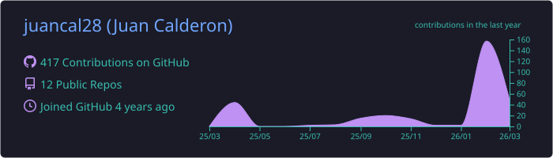
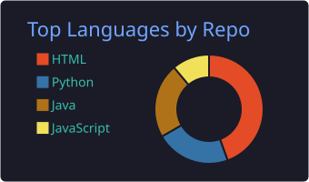
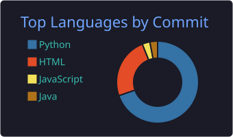
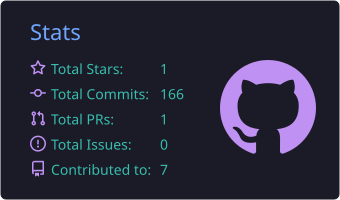

# Welcome to my GitHub!

## About Me

- **EECS & Mathematics student at UC Berkeley** (Class of 2028)
- **Former Software Engineer Intern at Microsoft** (Summer 2026) — built centralized OpenTelemetry + Azure Application Insights telemetry across 6 internal AI services, cross-service correctness gates for Model Context Protocol (MCP) workflows, and LLM evaluation infrastructure with QoS dashboards used by senior leadership
- **Former SDE Intern at AWS on the SageMaker team** (Summer 2025) — built CI/CD pipelines for ECS Fargate services, developed RAG agents over 100,000+ entry S3 buckets on SageMaker Unified Studio, and coordinated a team of 6 interns on a multi-agent application
- **Published researcher** — automated a molecular docking pipeline at Emory University that scaled to 2,000,000+ molecules on HPC clusters, leading to a peer-reviewed paper and a US patent on RNA polymerase inhibitory compounds
- Interested in **quantitative trading, distributed systems, and AI infrastructure**, and the mathematics behind them

## Projects

### [NBA Live-Game Trading Bot on Polymarket](https://github.com/juancal28/nba-total-score-bot)
A live NBA over/under trading bot written in Rust that trades on Polymarket's CLOB. It fits a Poisson process to first-quarter scoring via MLE, validates rate stability with a two-sample likelihood-ratio test, and bootstraps a 95% CI on the projected total to size edge against market-implied probability. Execution runs on a multi-threaded tokio runtime with lock-free order-book snapshots from CLOB WebSockets, VWAP slippage and staleness checks, EIP-712-signed FOK orders, and redb-persisted idempotent order IDs for crash-safe restarts. Risk controls include position caps, daily-loss limits, a blowout filter, and a feed-gap kill switch.

**Tech:** Rust, tokio, WebSockets, Polymarket CLOB, SportRadar, redb

### [News-Based, RAG-Assisted Trading System](https://github.com/juancal28/quantAlgoV1)
An autonomous pipeline that ingests financial news, scores sentiment with FinBERT, embeds articles into Qdrant, and generates RAG-based strategy proposals gated behind dual-window backtesting (252-day in-sample + 90-day out-of-sample), lookahead-bias guards, and human-in-the-loop approval. A $100K paper trading layer uses cross-sectional sentiment signals, VIX volatility gating, and 10% per-position caps. The hot-path execution code (backtest engine, cost model, broker, risk checks) is compiled to C++ via pybind11/CMake and validated by 24 parity tests against the Python reference implementations.

**Tech:** Python, C++, pybind11, FastAPI, Celery, Redis, PostgreSQL, Qdrant, FinBERT, Anthropic Claude, Alpaca API

### Homely — Home Services Marketplace
A dual-sided marketplace connecting homeowners with trade professionals, built on React 19 + Express with JWT auth, role-based access control, and real-time messaging, and shipped as a cross-platform PWA with CI/CD via GitHub Actions and Railway. Features a RAG-powered AI advisor (LangChain, Claude) and an MCP server that drives agentic workflows for contractor matching, job discovery, and scheduling.

**Tech:** TypeScript, React, Node.js, Express, PostgreSQL, Tailwind CSS, LangChain, Anthropic Claude, MCP, Railway

## Awards & Honors

- Jane Street FOCUS program participant (1 of ~40)
- Gates Scholarship recipient (1 of 750)
- Microsoft HOLA Scholarship recipient (1 of 13)
- Amazon Future Engineer Scholarship recipient (1 of 400)
- Top 5% on the 2024 AMC 12B

## Publications

- Xu, E., Park, S., **Calderon, J.**, et al. (2023). [In Silico Identification and In Vitro Validation of Repurposed Compounds Targeting the RSV Polymerase](https://doi.org/10.3390/microorganisms11061608). *Microorganisms*, 11(6), 1608.
- US Patent [20240415923 A1](https://patents.google.com/patent/US20240415923A1) — "RNA-Dependent RNA Polymerase Inhibitory Compounds" (Emory University, 2024)

## Tech Stack

### Languages

### Frameworks & Libraries

### Tools & Platforms

## GitHub Stats

  
   
  
  
   
  
   
  

